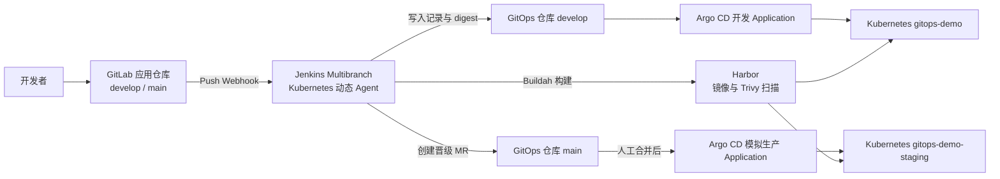

# Kubernetes GitOps 持续交付平台：项目交付记录

更新：2026-11-06。本文记录已在实验环境中完成的链路；命令检查的是执行时的实时状态，文中的历史镜像版本不代表当前版本。

## 1. 目标与范围

构建 GitLab、Jenkins、Harbor、Helm、Argo CD 和 Kubernetes 组成的持续交付链路。应用源码与部署配置分仓管理：开发分支自动测试、构建、扫描并部署到开发环境；代码经 MR 合入主分支后，复用开发阶段验证过的**同一镜像 digest**，由 Jenkins 创建部署配置 MR，经人工合并后交给 Argo CD 部署模拟生产环境。

这是单机房虚拟机实验环境。`gitops-demo-staging` 承担模拟生产角色；它不是独立的真实生产集群。示例应用无状态、无数据库，因此镜像回滚演练不包含数据恢复。

## 2. 架构



| 对象 | 地址或配置 | 作用 |
| --- | --- | --- |
| GitLab | `https://192.168.119.166/` | 源码、GitOps 配置、MR、Webhook |
| Harbor | `https://192.168.119.166:8443/` | 私有镜像仓库；Trivy 漏洞报告 |
| Jenkins | `http://jenkins.lab:30080/` | `gitops-demo-app-multibranch` 多分支流水线 |
| Argo CD | `https://argocd.lab:30443/` | 按 Git 声明状态同步 Kubernetes |
| 开发应用 | `demo.lab`，命名空间 `gitops-demo` | 跟踪 GitOps `develop` |
| 模拟生产应用 | `staging.demo.lab`，命名空间 `gitops-demo-staging` | 跟踪 GitOps `main` |

入口域名在实验客户端通过 hosts 解析到节点 IP，Ingress Controller 由 NodePort `30080/30443` 暴露。当前入口没有 VIP 或负载均衡器；固定节点下线后，指向该节点的访问地址会失效。

## 3. 仓库、分支与部署声明

- 应用仓库：`git@192.168.119.166:dev/gitops-demo-app.git`，本地目录 `/root/codex/project-study/gitops-demo-app-gitlab`。`develop` 承接开发提交；受保护的 `main` 接收应用代码 MR。`app.py` 是标准库 HTTP 服务，`Dockerfile` 用 Harbor 中的 Python 基础镜像构建。
- GitOps 仓库：`git@192.168.119.166:dev/gitops-demo-env.git`，本地目录 `/root/codex/project-study/gitops-demo-env`。`develop` 是开发环境声明；受保护的 `main` 是模拟生产声明，禁止直接推送，由 MR 合入。
- 两个 Argo CD Application 都读取 `charts/gitops-demo`，但分别跟踪 GitOps 的 `develop` 和 `main`，并读取各自分支中的 `values-env.yaml`。Chart 用 `.Release.Namespace` 设置资源命名空间；环境文件控制副本数、镜像与 Ingress host。
- Chart 在有 `image.digest` 时生成 `repository@sha256:...`；没有 digest 时回退到 `repository:tag`。实际发布以不可变 digest 为准，tag 保留便于阅读。

历史上 GitOps 仓库还存在 `release/staging`、`values-lab.yaml` 和 `values-staging.yaml` 等旧配置；当前两套 Application 的目标以集群中 `.spec.source` 为准，不应根据旧文件推断实时状态。

## 4. 发布流程与门禁

### 开发分支

1. GitLab Push Webhook `http://jenkins.lab:30080/gitlab-webhook/post` 触发 Jenkins 多分支任务。旧 `/project/gitops-demo-app` Webhook 已删除，避免普通旧 Pipeline 重复触发。
2. Checkout 后执行 Python HTTP 行为测试：`/healthz`、`/api/info` 和 404 路径。测试使用禁用代理的本机请求。
3. 只有 `develop` 本次变更包含 `app.py`、`Dockerfile` 或 `.dockerignore` 时，才执行 Buildah 构建和推送。单改 Jenkinsfile、测试或 README 会运行测试，但不生成镜像。
4. `Image Smoke Test` 在构建后启动最终镜像内的应用，检查健康接口和写入镜像的版本、提交信息。失败时不更新 GitOps。
5. Harbor Trivy 扫描报告必须生成，且 Critical/High 漏洞数为零；扫描失败、超时或达到阈值时停止发布。
6. Jenkins 把镜像 tag 与 digest 写入 GitOps `develop/charts/gitops-demo/values-env.yaml`，并创建 `releases/by-source/<source SHA>.json`，记录源码提交、构建提交、输入指纹、镜像 tag 和 digest。Argo CD 自动同步开发环境。

### 模拟生产分支

1. 应用代码通过 `develop → main` MR 合入。当前发布记录按最近一次修改 `app.py`、`Dockerfile`、`.dockerignore` 的提交 SHA 查找，因此此 MR 不使用 Squash；合并时保留 `develop` 分支。
2. Jenkins `main` 子任务运行同一套源码测试，跳过构建和推送。它从 GitOps `develop/releases/by-source/` 精确查找记录，并比较构建输入指纹，拒绝找不到记录或源码不一致的晋级。
3. Jenkins 从 GitOps `main` 创建候选分支，只修改生产 `values-env.yaml` 的镜像 tag、digest，再通过 GitLab API 创建 MR。受保护的 `main` 不接受 Jenkins 直接推送。
4. 人工审核并合并 GitOps MR 后，Argo CD 自动同步模拟生产环境。开发与模拟生产 Deployment 曾验证运行同一个 `@sha256` digest，两个 Application 为 `Synced / Healthy`。

同一应用 `main` 提交重复运行时，候选分支名称固定；如果对应 MR 仍打开，Jenkins 返回原 MR 地址，不重复创建。**当前实现只查询打开的 MR**：关闭提案后再次重跑，可能重新创建提案。回滚后重跑当前应用 `main`，也可能提出将当前代码重新晋级的 MR；它不会自动合并。

## 5. 凭据与镜像来源

| 凭据 ID / Secret | 用途 |
| --- | --- |
| `gitlab-app-readonly` | Jenkins 通过 SSH 只读检出应用仓库 |
| `gitlab-env-write` | Jenkins 读 GitOps 分支、推送开发配置与生产候选分支 |
| `gitlab-env-mr-api` | GitLab API 查询、创建 GitOps MR |
| `harbor-jenkins-push` | Buildah 推镜像、读取 Harbor 扫描报告 |
| `harbor-pull` | `jenkins`、`gitops-demo`、`gitops-demo-staging` 命名空间拉取私有镜像 |

Jenkins 动态 Agent 的 `jnlp`、`buildah`、`python-test` 镜像及应用 Python 基础镜像均已放入 Harbor。`jnlp` 地址由 Jenkins Helm values 的 `agent.image` 配置；一次新 Agent 构建已验证使用 Harbor 地址并成功完成。凭据值不写入仓库或交付文档。

## 6. 回滚与故障边界

- Jenkins 在测试、构建、镜像启动检查、扫描或候选校验阶段失败时，GitOps 生产 `main` 不变，模拟生产无需回退。
- 合并 GitOps 生产 MR 后若部署异常，基于上一版已验证的 tag 与 digest 创建**新的 GitOps 回滚 MR**；合并后 Argo CD 将 Deployment 同步到旧 digest。已完成一次该路径的回滚演练，并观察到模拟生产镜像切换。
- 不应只用 `kubectl rollout undo` 作为持久回滚手段，因为 Git 中的声明状态仍指向新版本，Argo CD Self Heal 可能再次同步它。
- 示例应用无状态。将来若接入 MySQL，回滚镜像不等于回滚表结构或业务数据；数据库变更需要兼容性迁移、备份与单独的恢复方案。

已排查的环境故障包括：Calico CNI kubeconfig token 过期导致动态 Agent Pod 网络沙箱创建失败；Trivy 漏洞库下载受代理节点影响；Jenkins 调用 GitLab API 时需信任实验 CA。它们属于平台依赖故障，与应用测试失败应分别定位。

## 7. 复核命令

```bash
# 当前 Argo CD 分支、目录、同步与健康状态
kubectl -n argocd get application gitops-demo gitops-demo-staging \
  -o custom-columns=NAME:.metadata.name,BRANCH:.spec.source.targetRevision,PATH:.spec.source.path,SYNC:.status.sync.status,HEALTH:.status.health.status

# 两环境实际 Deployment 镜像；晋级后比较 @sha256 是否相同
kubectl -n gitops-demo get deployment gitops-demo \
  -o jsonpath='{.spec.template.spec.containers[0].image}{"\n"}'
kubectl -n gitops-demo-staging get deployment gitops-demo \
  -o jsonpath='{.spec.template.spec.containers[0].image}{"\n"}'

# 模拟生产 rollout
kubectl -n gitops-demo-staging rollout status deployment/gitops-demo

# 本地源码行为测试
cd /root/codex/project-study/gitops-demo-app-gitlab
python3 -m unittest discover -s tests -v

# Jenkins Helm 版本与状态
helm list -n jenkins
kubectl -n jenkins get pods
```

完整流水线见应用仓库 `Jenkinsfile`；Chart 见 GitOps 仓库 `charts/gitops-demo`；基础组件安装记录与命令见本目录 `README.md`。检查实时状态时先看集群和 GitLab 当前分支，不把本文的历史验证值当作当前值。

## 8. 面试讲述要点

> 基于 GitLab、Jenkins、Harbor、Helm 与 Argo CD 搭建 Kubernetes GitOps 持续交付平台，采用应用源码与环境配置分仓、开发与模拟生产双分支管理。通过 GitLab Webhook 驱动 Jenkins Kubernetes 动态 Agent，完成源码测试、Buildah 镜像构建、最终镜像启动验证及 Harbor Trivy 漏洞门禁；以镜像 digest 和源码指纹记录可追溯交付物。开发环境自动同步，生产晋级复用同一镜像 digest，由 Jenkins 自动创建受保护配置仓库的 MR，经人工审核后交由 Argo CD 部署；验证了失败阻断、重复执行去重、跨环境一致性与 GitOps 回滚流程。

讲述时区分已验证的实验能力与生产化待办：目前没有高可用统一入口、独立生产集群、强制审批规则或有状态数据迁移回滚。
